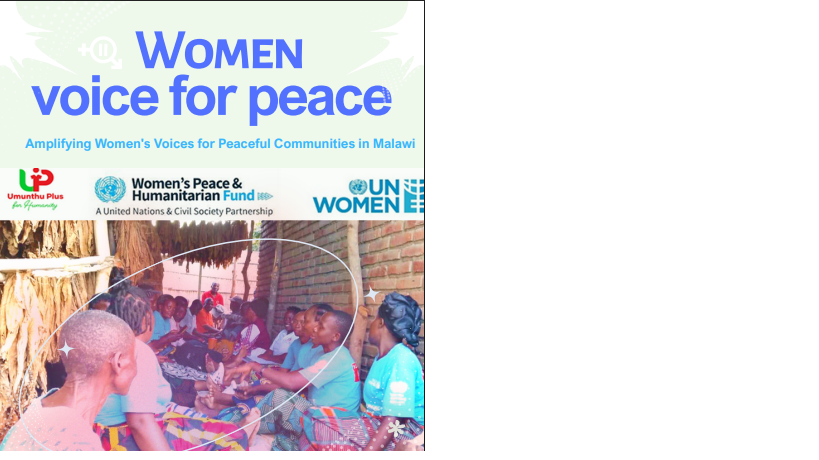
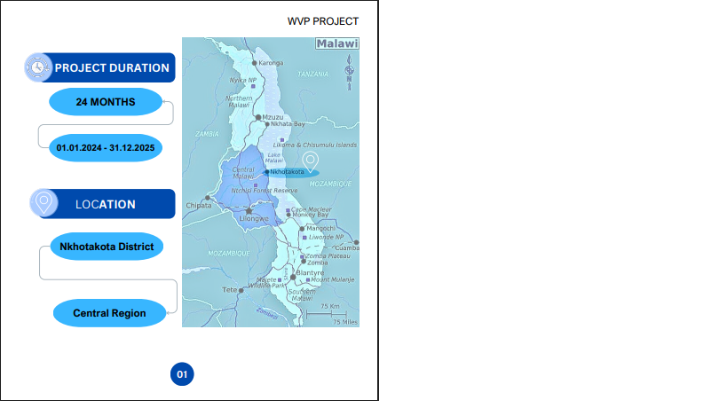
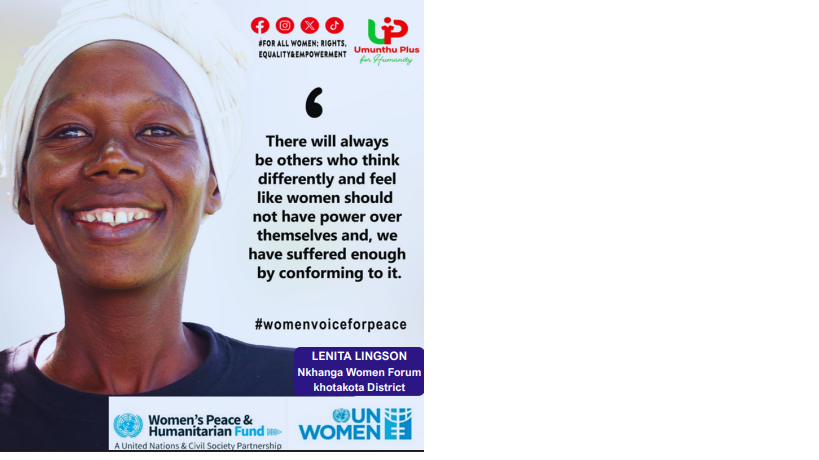

#Media-Kits-Gallery
## Executive Summary
I designed a 16-page media kit for the **Women’s Voice for Peace (WVP) Project**, implemented by **UmunthuPlus** in **Nkhotakota District, Malawi**Using **Canva**, I transformed detailed project information into a clear, visually engaging communication tool for stakeholders, partners, donors, and community audiences.

My role focused on designing the layout, organising complex information, creating a strong visual hierarchy, and ensuring the final media kit was professional, accessible, and aligned with the project’s advocacy goals.

  

## Project Overview
The WVP Project is a 24-month initiative running from **1 January 2024 to 31 December 2025**. It was funded by the **Women’s Peace and Humanitarian Fund (WPHF)** through **UN Women Malawi** and implemented by **UmunthuPlus** in **Nkhotakota District, Central Region, Malawi**.

The project aim was to strengthen women’s participation in conflict prevention, promote gender-sensitive peacebuilding mechanisms, and improve the responsiveness of local leaders, Civil Society Organisations (CSOs), and council-level duty bearers.

  

I designed the media kit to communicate these goals in a simple, visually appealing way that could be used during stakeholder meetings, donor briefings, community engagements, and media outreach.
## My Design Role
Using **Canva**, I was responsible for the visual design and presentation of the media kit. To create the document, my main tasks included:
- Designing a clear and professional 16-slide layout.
- Organising detailed project information into easy-to-understand sections.
- Creating a consistent visual identity using colours, fonts, icons, and spacing.
- Using maps, timelines, icons, and visual elements to make the content easier to follow.
- Structuring the slides so stakeholders could quickly understand the project’s purpose, target groups, strategies, and expected results.
- Ensuring the design reflected the project’s focus on women’s empowerment, inclusion, peacebuilding, and community participation.
- Reviewing the layout for readability, consistency, alignment, and professional presentation.

  ## Design Approach: How I Created the Document

### 1. Clear Information Structure
The project contained a large amount of information, including objectives, outcomes, outputs, target groups, strategies, and cross-cutting issues. I organised this information into distinct sections so that readers could follow the project story easily. Each slide focused on one main message, helping stakeholders understand the project without feeling overwhelmed by text.

### 2. Strong Visual Hierarchy
I built the layout in Canva to establish a clear visual hierarchy through:
- Bold headings to highlight key sections.
- Numbered sections to guide readers through the media kit.
- Icons and symbols to represent key themes.
- Colour blocks to separate content and improve readability.
- Maps and timelines to show the project location and duration.
- Consistent fonts, spacing, and alignment to create a polished final design.

  

### 3. Human-Centred Storytelling
To make the media kit more engaging, I included quotes and perspectives from women’s forums in Nkhotakota District, including the **Nkhanga Women’s Forum** and the **Kanyenda Women’s Forum**. This helped shift the design from being purely informational to telling a human-centred story about women’s voices, participation, and leadership in peacebuilding.

### 4. Inclusive and Accessible Design
I ensured that the design reflected the project’s commitment to inclusion by visually presenting the different groups the project seeks to support, alongside cross-cutting themes such as gender sensitivity, disability mainstreaming, community-based systems, and women’s empowerment:
- Young women and girls
- Older women
- Female sex workers
- Transgender women
- Women with disabilities
- Women living with HIV/AIDS
- Women-led civil society organisations
  ## Media Kit Content I Designed
The 16-slide media kit was structured into the following sections to build a logical flow from project identity to impact and attribution:

| Section | Design Focus |
| :--- | :--- |
| **Cover and community voices** | Project branding, partner logos, and quotes from women forum members |
| **Project overview** | Project timeline, location, and geographic context |
| **Goals and strategies** | Objectives and intervention strategies targeting 3,200 women |
| **Cross-cutting issues** | Inclusion, empowerment, disability mainstreaming, and community systems |
| **Target groups** | Priority groups supported by the project |
| **Outcomes and outputs** | Expected results, dialogues, committees, women’s groups, and digital linkage |
| **Approach and attribution** | Inside-Out Approach, partner recognition, website, and social media details

## Key Design Outcomes
Through this project, I demonstrated my ability to:
- Use Canva to create professional communication and advocacy materials.
- Turn complex project information into clear, visually appealing slides.
- Apply strong layout, typography, colour, and visual hierarchy skills.
- Design materials that support stakeholder engagement and advocacy.
- Present development and peacebuilding information in an accessible way.
- Ensure consistency, readability, and professional presentation across a multi-page document.

ACCESS FULL DOCUMENT ([Click Here](https://drive.google.com/file/d/1NXarD5PlhL1-aNZdv17bcsXry1Djxgl5/view?usp=drive_link))

  ## Tools & Skills Used
- **Canva:** Slide design, layout, typography, icons, colour, visual hierarchy, and final presentation.
- **Strategic communication:** Translating project objectives and results into stakeholder-friendly messages.
- **Content organisation:** Structuring detailed project information into a clear and logical flow.
- **Proofreading and quality control:** Reviewing the design for accuracy, consistency, and readability.
